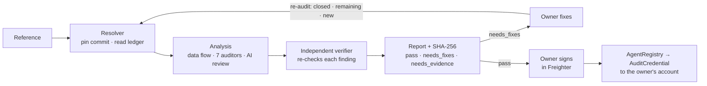

<p align="center">
  
</p>

<h1 align="center">touchmark</h1>

<p align="center">
  <strong>Test the agent. Stamp the proof.</strong><br>
  Before an AI agent gets your keys, Touchmark reads its code, tries to misuse it, and stamps the result on Stellar, where anyone can check it.
</p>

<p align="center">
  <a href="https://touchmark-stellar.vercel.app"></a>
  
  <a href="https://github.com/furkan3152/agentveritas-stellar/actions/workflows/verify.yml"></a>
  
  
</p>

<p align="center">
  <a href="public/media/touchmark-how-to.mp4"></a><br>
  <sub>▶ <a href="public/media/touchmark-how-to.mp4">How to use Touchmark</a>: paste an agent, read the verdict, fix and re-test, stamp it on Stellar.</sub>
</p>

> A **touchmark** is the maker's mark struck into tested metal: a promise that someone checked it and stands behind it. Touchmark (formerly AgentVeritas) does the same for AI agents that hold Stellar keys.

---

## The demo

**[touchmark-stellar.vercel.app](https://touchmark-stellar.vercel.app)**: one box, one button.

1. **Paste** a GitHub repository or folder, an AgentRegistry agent id, a `C…` contract or a `G…` account.
2. **Read the verdict.** The exact commit is pinned, the code is traced from model input to keys, payments and the network, and a report is committed with its SHA-256 hash. "Why this score?" shows every point deducted.
3. **Issue the credential.** If the audit passes, a validator writes the report hash and score to the registry on Stellar testnet, a Soroban contract issues a credential bound to them, and the page reads it back from the ledger.
   - **To your account:** add `touchmark.json` with `{"stellar_owner": "G…"}` to your repository. You then sign the registration in Freighter, and the credential is issued to your account.
   - **Declare your agent** in the same file (`purpose`, `tools` with `spend_limit_usdc`, `forbidden_goals`). The audit checks the code against what you declare; a limit the code does not enforce is reported, not credited.
4. **Fix and re-audit.** Paste the fixed commit; the page shows which risks were closed and how the score changed.

| An unsafe agent: not yet | The same agent, fixed: touchmarked on Stellar |
|---|---|
|  |  |

Both are the same MCP treasury agent, in [`examples/demo`](examples/demo). In the unsafe
one the model picks the recipient, the amount and the URL to fetch. In the safe one,
recipients come from a fixed table, amounts are capped and invoices come from one host.

## Why Stellar: the chain enforces the rules

The credential is not a minted NFT carrying a label. The contracts decide whether it may
exist and whether it is still valid:

- **Authorization.** `require_auth` is required on every role: owner, requester,
  validator and revoker.
- **Owner-signed credentials.** When a repository names its owner, the owner's own
  wallet signs the registration, and the credential is issued to that account. Neither
  the demo server nor anyone else can register the agent in the owner's name.
- **Validator authority.** Only a validator the registry approved can complete a
  validation, and only the one pinned when the request was made. Removing a validator
  invalidates every credential it issued, immediately.
- **Version–report binding.** A validation records the agent's version, metadata hash and
  endpoint hash with the report hash. If the agent changes, the response, the issuance
  and `is_current` all fail.
- **Pass gate.** The credential contract refuses scores below 65.
- **Revocation and expiry.** The owner or issuer can revoke, and the first reason is
  permanent. Validity is at most 90 days. Credentials cannot be transferred.
- **Spend-limited agent account.** A custom account (`__check_auth`) gives an agent
  session keys limited by recipient, asset, per-call maximum and a cumulative budget,
  which the owner can revoke or shut down.
- **No upgrade authority.** No contract can be upgraded, not even by its admin.

Off-chain, the resolver reads contracts and accounts straight from the ledger. It reads
the WASM, recomputes its hash, and reads the spec (SEP-48) and metadata (SEP-46). It also
reads signers and thresholds, and uses SEP-53 for ownership proofs. The rules know
Stellar-specific dangers:
- payment and account operations, `authorizeEntry`, foreign envelope signing and x402;
- Soroban `require_auth` and TTL gaps;
- SEP-10/45 boundaries;
- unchecked transaction success.

## Evidence, and what is not yet proven

| Claim | Status |
|---|---|
| 46 labelled agents (Python + TS): 28 TP, 18 TN, 0 FP, 0 FN | Reproducible with `scripts/evaluate.py`. Written by us and used in development, so this is a regression measure. |
| 199 findings on 12 open-source Stellar agents checked by hand: 161 true, 32 partly true, 5 false | Self-verified with one annotator; recall unknown. The dataset is hash-committed now and published after disclosure. |
| Automatic second-opinion verifier: refutes 3/5 false findings, never refuted a true one (0/42), κ 0.65 against hand labels | Calibrated with `scripts/calibrate_verifier.py`; self-verified. |
| Contract rules enforced | 57 contract tests plus testnet transactions. **Not externally audited, not on mainnet.** |
| Credentials go only to the owner who signs | Testnet run with the owner's four transactions, in [`deployments/demo-testnet.json`](deployments/demo-testnet.json). A registration signed by another account and an unsigned request were both refused. |
| Adoption | None yet: no outside users, and not yet indexed by ecosystem directories. |

The full claims ledger, the method and the **evidence milestones** this project is
working toward are in **[docs/EVIDENCE.md](docs/EVIDENCE.md)**:
- coordinated disclosure;
- an independent benchmark;
- an external contract audit;
- governance hardening;
- outside users.

## How it works



The components, the score formula, the contract state machine, the self-assessed
contract security review and the trust boundaries are described in
**[docs/ARCHITECTURE.md](docs/ARCHITECTURE.md)**.

## Run it

```bash
python3 -m venv .venv && .venv/bin/pip install -r requirements.txt
.venv/bin/python scripts/audit_agent.py https://github.com/owner/repo --no-deep   # rules only, no API key
ENABLE_DEEP_REVIEW=1 ENABLE_FINDING_VERIFICATION=1 \
  .venv/bin/python scripts/audit_agent.py <ref> --compare <fixed-ref>            # AI review + verification + re-audit
.venv/bin/uvicorn app:app --port 8000                                            # demo at /, Studio at /studio
.venv/bin/python scripts/evaluate.py                                             # reproduce the evaluation
.venv/bin/python -m pytest -q && cargo test --workspace                          # tests
```

To issue credentials from your own deployment, run `scripts/deploy_demo_testnet.py`, then
set `DEMO_OPERATOR_SECRET`.

## Limits

- The analysis is **static**. Logic flaws that are not a flow from input to a sink are
  left to the AI review, and there is no runtime guarantee.
- Chain rules are **Stellar-specific**.
- The demo runs on **testnet**, where one operator is both admin and validator.
- Ownership means control of the repository and of the named key, not legal identity.
- A pass means no actionable risk was found in the reviewed code. **It is not a
  certificate of safety.**

[Architecture](docs/ARCHITECTURE.md) · [Evidence](docs/EVIDENCE.md) · [Deployments](deployments/README.md) · [Security policy](SECURITY.md) · [Contributing](CONTRIBUTING.md) · [Apache 2.0](LICENSE)
